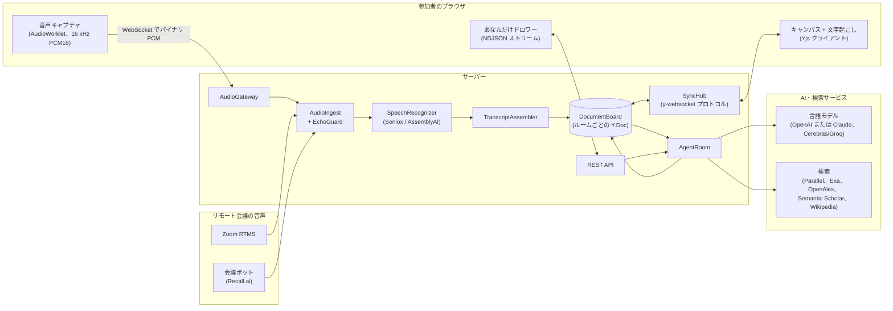
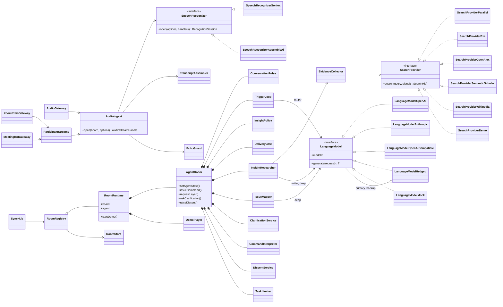
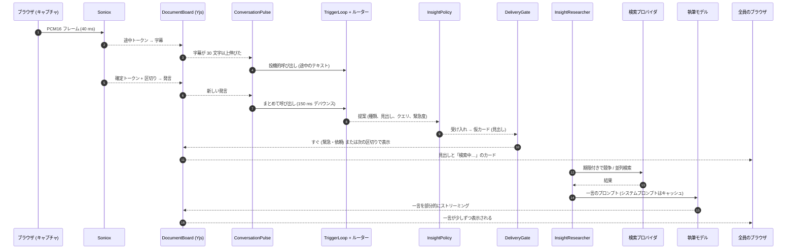
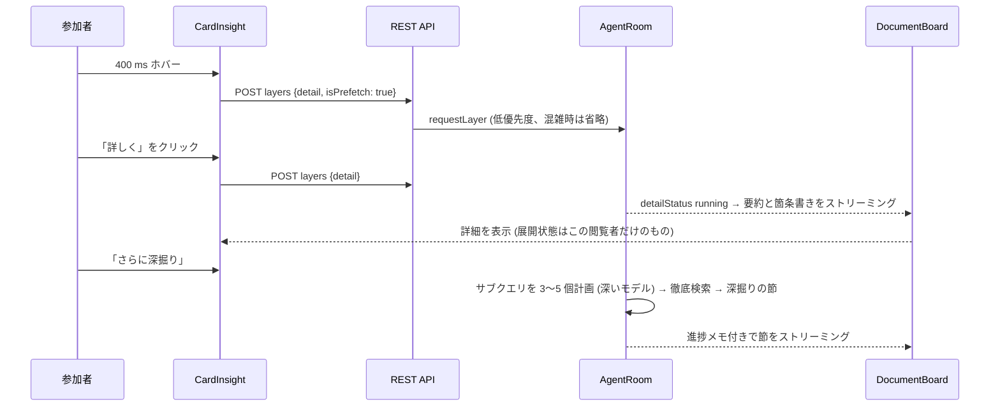
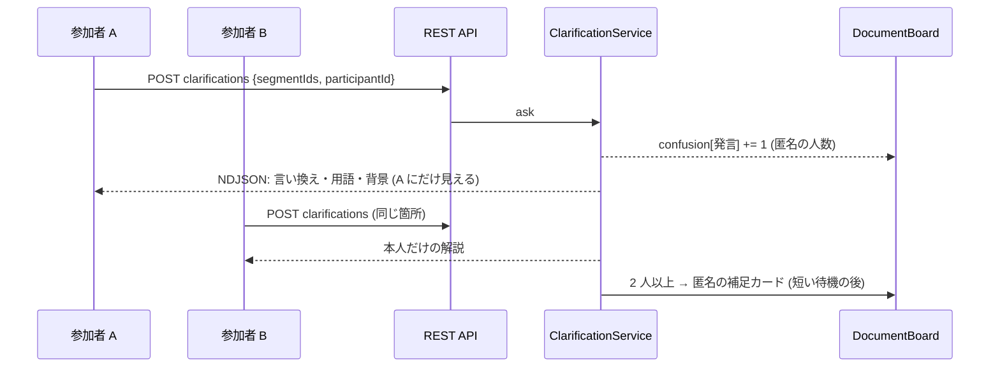
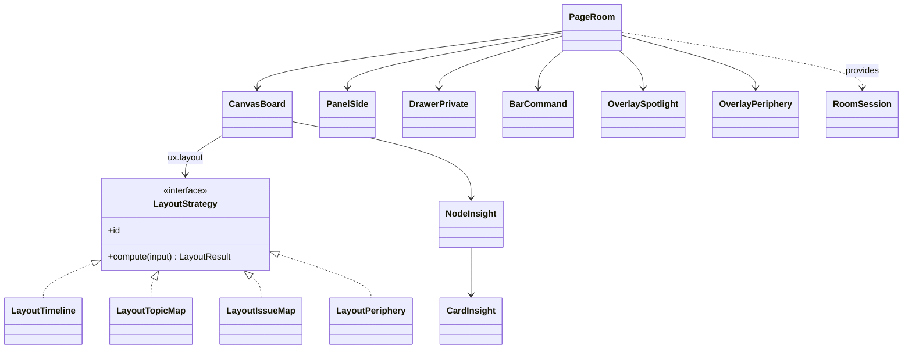

# アーキテクチャ

[English](Architecture.md)

EkklesiazousAI は TypeScript のモノレポ (pnpm workspaces) です。

| パッケージ        | 役割                                                                                                                                                                                         |
| ----------------- | -------------------------------------------------------------------------------------------------------------------------------------------------------------------------------------------- |
| `Packages/Shared` | ドメインモデル (`Insight`、`TranscriptSegment`、`IssueNode` など)、Yjs ボードへの型付きアクセサ `DocumentBoard`、UX 機能レジストリ、通信プロトコル。サーバーとクライアントの両方が使います。 |
| `Apps/Server`     | Node.js サーバー: 音声の取り込みと音声認識、ルームごとのエージェント、Yjs 同期ハブ、REST API、Zoom RTMS と会議ボットのゲートウェイ。                                                         |
| `Apps/Client`     | Vue 3 クライアント: レイアウトを切り替えられる無限キャンバス (Vue Flow)、文字起こしパネル、「あなただけ」ドロワー、コマンドバー、音声キャプチャ、設定、Google Meet アドオン用ページ。        |

## システム全体像

共有の Yjs ドキュメントが唯一の正です。音声認識は字幕と発言をここに書き込みます。エージェントはここを監視し、インサイト・話題・論点マップのノード・用語集を書き戻します。各ブラウザは同期されたコピーを持つので、全員が同じボードを見ます。レイアウトは参加者ごとに選べ、実験のためにルームで固定することもできます。

## 共有データモデル (Yjs のコレクション)

| コレクション | 内容                                                                                  | 書き込む主体                                      |
| ------------ | ------------------------------------------------------------------------------------- | ------------------------------------------------- |
| `meta`       | 会議名、場所、取り込み方法、エージェントの状態、UX 設定、積極性、スポットライト、要約 | 参加者、エージェント                              |
| `speakers`   | 話者 ID → 名前と色                                                                    | 音声認識 (参加者が名前を変更可)                   |
| `segments`   | 確定した発言 (追記のみ)                                                               | 音声認識 / デモ再生                               |
| `captions`   | 音声ストリームごとの話し途中の字幕                                                    | 音声認識                                          |
| `insights`   | カード: 種類、きっかけのパターン、一言・詳細・深掘りの各層、出典、時刻計測、投票      | エージェント (参加者は投票・固定・非表示)         |
| `topics`     | 議論の話題                                                                            | エージェント                                      |
| `issues`     | IBIS のノード (問い・案・賛成・反対・決定)                                            | エージェント (参加者が編集するとそのノードは固定) |
| `glossary`   | 会議中に解説した用語                                                                  | エージェント                                      |
| `confusion`  | 発言ごとの、こっそり質問した人数 (匿名)                                               | エージェント                                      |
| `notes`      | 付箋                                                                                  | 参加者                                            |
| `placements` | レイアウトごとの手動配置                                                              | 参加者                                            |

こっそり解説と「自分だけ」の調査結果はボードに書き込まれず、依頼者にだけ HTTP の NDJSON で返されます。

## サーバーの構成要素

| 構成要素               | 責務                                                                                                                                                                                                                          |
| ---------------------- | ----------------------------------------------------------------------------------------------------------------------------------------------------------------------------------------------------------------------------- |
| `ConversationPulse`    | ボードの変化をイベントに変換します: 新しい発言、話し途中の字幕、会話の区切り (0.7 秒以上の間、または話者交代)。                                                                                                               |
| `TriggerLoop`          | 高速なルーターを呼び出します。確定発言はまとめて (デバウンス) 送り、伸びていく字幕には**投機的に**呼び出し、呼びかけ語の命令はすぐ回します。同時に動かす呼び出しは 1 つだけです。                                             |
| `InsightPolicy`        | 受け入れ判定: 有効な種類、積極性のしきい値、重複 (文字バイグラム類似度、用語集)、あれば便利程度のカードの毎分上限 (緊急のものは対象外)。                                                                                      |
| `DeliveryGate`         | 表示タイミング (UX 機能): すぐ、次の区切り (最大 6 秒待機)、定期的なまとめ、または表示しない (`shadow`、研究用ベースライン)。最小待機時間で匿名項目と投稿者のタイミングを切り離します。                                       |
| `InsightHandle`        | 調査中のインサイト。表示されるまでは更新をメモリに保持し、表示後はボードに書きます。                                                                                                                                          |
| `InsightResearcher`    | 段階的な層を書きます: 一言 (高速モデル)、詳細 (高速モデル)、深掘り (サブクエリを計画する深いモデル)。部分 JSON をカードへストリーミングします。                                                                               |
| `EvidenceCollector`    | 種類と深さに応じた検索計画。「さっと」は Web 検索を競わせて最初の有用な結果を採用します (期限 1.8 秒)。「標準」は日英のクエリに学術・百科事典を加えて並列実行します (2.8 秒)。「じっくり」は計画したクエリを足します (9 秒)。 |
| `IssueMapper`          | 新しい発言があれば約 40 秒ごとに、深いモデルで IBIS マップを作り直します。カードをノードに結び付け、要約を更新し、吟味されないまま採用されそうな案 (問いかけの対象) を検出します。人が編集したノードは変更しません。          |
| `ClarificationService` | こっそり解説・聞き逃しの要約、匿名の質問人数、2 人以上が同じ箇所で困ったときの匿名補足カードへの昇格。                                                                                                                        |
| `DissentService`       | 参加者の匿名の懸念を、エージェント自身の問いかけとして書き直します (参加者ごとに頻度制限)。                                                                                                                                   |
| `EventLog`             | ルームごとの追記専用 JSONL。処理イベント (ルーターの遅延、抑制とその理由、表示、層の時刻) と参加者の操作を記録します。                                                                                                        |
| `EchoGuard`            | 他のストリーム (会議タブ) がすでに書き起こした発言の重複を、マイク側から取り除きます。                                                                                                                                        |
| `SyncHub`              | 最小限の y-websocket サーバー (同期と awareness)。ブラウザがつながっているドキュメントそのものをエージェントが編集できます。                                                                                                  |

## 主なシーケンス

### 発言からカードまで

遅延の目安 (「さっと」、発言終了から):

| 段階                                                              | 目標        |
| ----------------------------------------------------------------- | ----------- |
| ルーターの判断 (Cerebras/Groq。450 ms で執筆モデルに保険をかける) | 0.3〜0.7 秒 |
| 仮カードが全員の画面に出る (Yjs 同期)                             | 1 秒未満    |
| 「さっと」検索 (競争)                                             | 0.2〜1.8 秒 |
| 一言の最初の語 (ストリーミング)                                   | 1.1〜2.5 秒 |
| 一言の完成                                                        | 1.5〜3 秒   |

話し途中の投機的ルーティングにより、話者が言い終わる前にカードが出ることもよくあります。各カードは `utteranceAt`、`triggeredAt`、`firstContentAt`、`readyAt`、`releasedAt` と各層の依頼・完成時刻を記録します。カードには「発言から N 秒で提示」と表示され、イベントログにはすべてが残ります。

### 段階的な開示

依頼の深さで、最初から作る層が決まります。「さっと」は一言だけ、「標準」は詳細まで、「じっくり」はすべてを作ります。残りは求められたときに作ります。

### こっそり解説と匿名での昇格

### 匿名の問題提起

参加者が懸念を送ると、`DissentService` がそれを中立的に書き直し、投稿者が分かりそうな表現を取り除きます。攻撃的・無関係な内容は投稿しません。そのうえでエージェント自身の「問いかけ」カードとして出します。最低 8 秒待ち、次の区切りで表示するので、表示のタイミングから誰が入力したかは分かりません。

## クライアントの構成

| フォルダ       | 内容                                                                                                                                                                                                     |
| -------------- | -------------------------------------------------------------------------------------------------------------------------------------------------------------------------------------------------------- |
| `Services/`    | `BoardConnection` (Yjs + y-websocket)、`RoomSession` (provide/inject)、`ApiClient`、`PrivateFeed`、`AudioCapture`、`InteractionLogger`、`ParticipantIdentity`、`MeetAddon`                               |
| `Composables/` | `UseBoardState` (コレクションごとのリアクティブなスナップショット)、`UsePresence` (awareness)、`UseClarification`、`UseNow`                                                                              |
| `Layouts/`     | 純粋関数のレイアウト戦略: `LayoutTimeline`、`LayoutTopicMap`、`LayoutIssueMap`、`LayoutPeriphery`                                                                                                        |
| `Components/`  | `Canvas/` (Vue Flow のボードとノード)、`Card/`、`Overlay/` (スポットライト、周辺トレイ、通知)、`Transcript/`、`Private/`、`Command/`、`Toolbar/`、`Audio/`、`Settings/`、`Lobby/`、`Room/`、`MeetAddon/` |
| `Locales/`     | 英語 (既定) と日本語の UI 文字列                                                                                                                                                                         |

レイアウトは、ボードの状態から配置済みの要素を返す純粋関数です。手で動かした位置はレイアウトごとに `placements` に保存されるので、各レイアウトがそれぞれの配置を保ちます。

## 音声の経路

| 取り込み方法           | 経路                                                                             | 話者                                                                        |
| ---------------------- | -------------------------------------------------------------------------------- | --------------------------------------------------------------------------- |
| `roomMicrophone`       | ブラウザのマイク (エコー除去・ノイズ抑制・自動ゲインはオフ) → 1 本のストリーム   | Soniox が話者分離                                                           |
| `onlineHostCapture`    | 会議タブまたはシステム音声と、ホストのマイク (別ストリーム)                      | タブ: 話者分離。ホストのマイク: ホストの名前。回り込みは `EchoGuard` が除去 |
| `onlinePerParticipant` | 参加者がそれぞれ自分のマイクを送る                                               | 各参加者の名前                                                              |
| `zoomRtms`             | Zoom → Webhook → シグナリング・メディアの WebSocket → 参加者ごとに認識ストリーム | Zoom の表示名                                                               |
| `meetingBot`           | Recall.ai ボット → WebSocket → 参加者ごとに認識ストリーム                        | 会議の表示名                                                                |
| `demo`                 | `DemoPlayer` が日英混在のスクリプト会議を書き込む                                | スクリプト                                                                  |

## 保存とログ

- ルームのドキュメントは、変更の 2 秒後に `Apps/Server/Data/Rooms/<roomId>.yjs` へ Yjs のスナップショットとして保存されます。
- 研究用ログは `Apps/Server/Data/Logs/<roomId>.jsonl` にあります。
- `GET /api/rooms/:roomId/minutes` で Markdown の議事録 (要約、論点マップ、出典付きインサイト、用語集、文字起こし) を出力できます。

## プライバシーとセキュリティ

- API キーはサーバーにだけ置きます。ブラウザが AI サービスと直接通信することはありません。
- こっそり解説と「自分だけ」の調査は依頼者にだけ返し、共有ドキュメントには書きません。依頼には名前ではなく、ブラウザごとのランダム ID だけが付きます。
- 音声が端末から出る前に同意ダイアログを出します。文字起こし中は「録音中」の表示が出ます。
- ルームの保護は推測できない ID だけで、まだ認証はありません。信頼できるネットワーク内か、独自のアクセス制御の内側で動かしてください。
