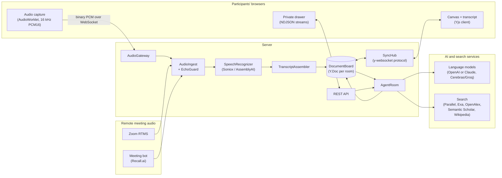
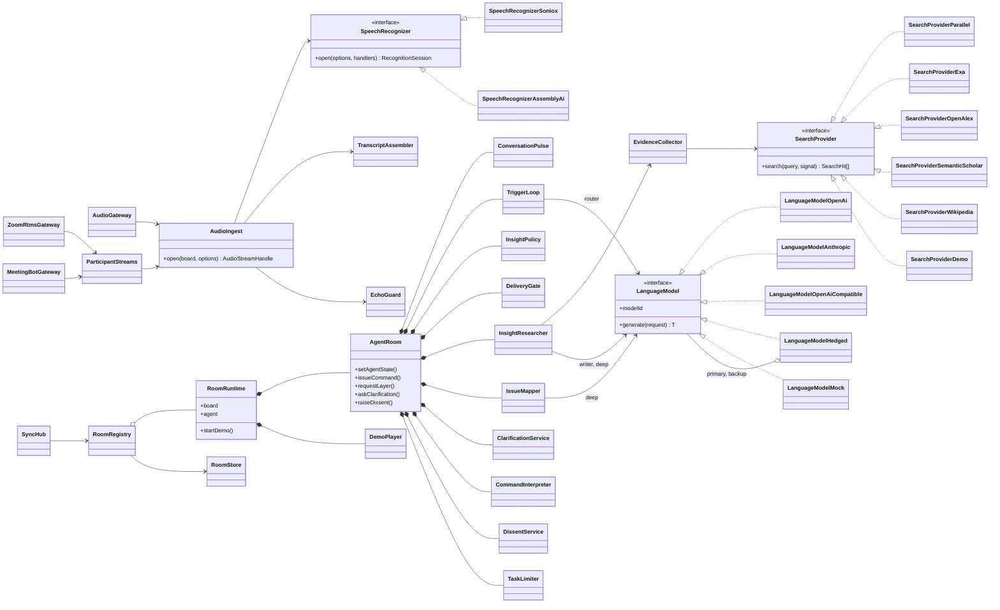
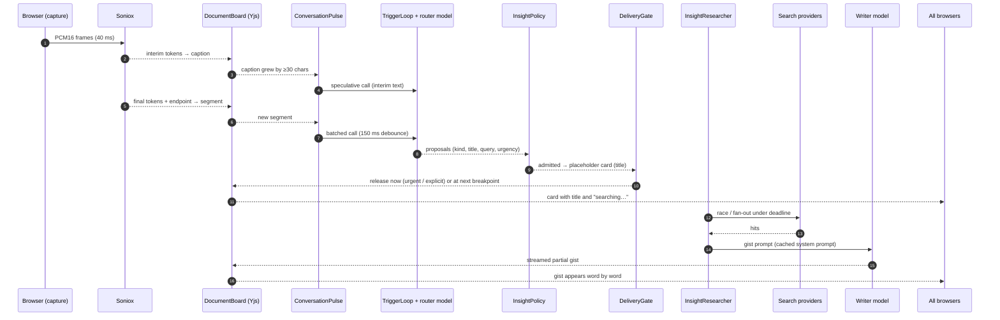
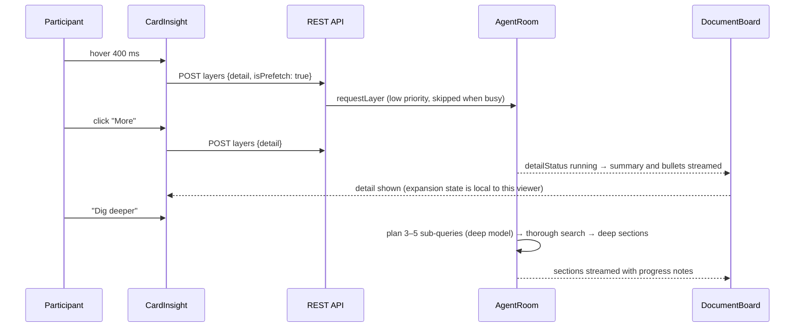
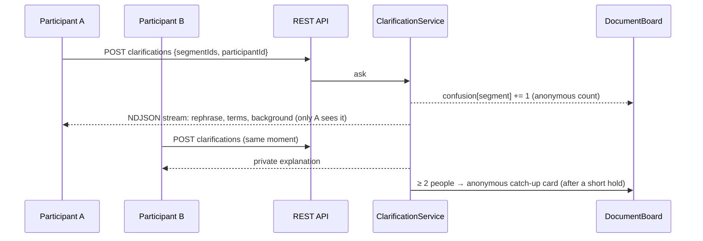
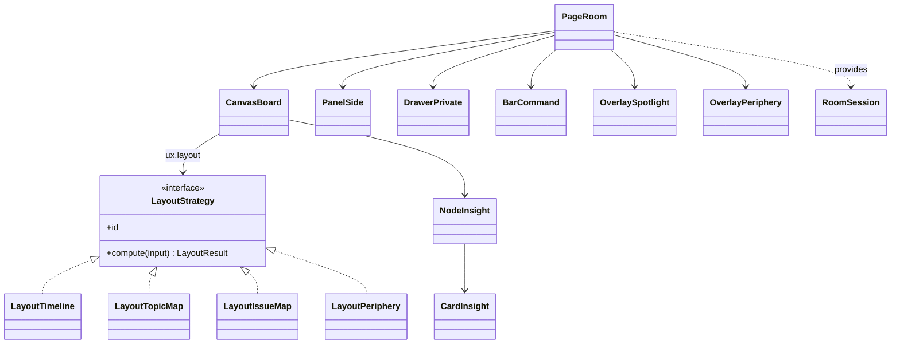

# Architecture

[日本語](Architecture.ja.md)

EkklesiazousAI is a TypeScript monorepo (pnpm workspaces):

| Package           | Role                                                                                                                                                                         |
| ----------------- | ---------------------------------------------------------------------------------------------------------------------------------------------------------------------------- |
| `Packages/Shared` | Domain model (`Insight`, `TranscriptSegment`, `IssueNode`, …), the typed Yjs board accessor `DocumentBoard`, the UX feature registry and wire protocols. Used by both sides. |
| `Apps/Server`     | Node.js server: audio ingestion and speech recognition, the per-room agent, the Yjs sync hub, the REST API, Zoom RTMS and meeting-bot gateways.                              |
| `Apps/Client`     | Vue 3 client: infinite canvas (Vue Flow) with switchable layouts, transcript panel, private drawer, command bar, audio capture, settings, Google Meet add-on pages.          |

## System overview

The shared Yjs document is the single source of truth. Speech recognition writes captions and segments into it. The agent observes it and writes insights, topics, issue-map nodes and the glossary back. Every browser holds a synced copy, so all participants see the same board. Each participant chooses their own layout, and the room can lock layouts for experiments.

## Shared data model (Yjs collections)

| Collection   | Content                                                                                          | Written by                                |
| ------------ | ------------------------------------------------------------------------------------------------ | ----------------------------------------- |
| `meta`       | Title, platform, capture mode, agent state, UX settings, proactivity, spotlight, rolling summary | Participants, agent                       |
| `speakers`   | Speaker id → label and color                                                                     | Recognizer (renamable by participants)    |
| `segments`   | Finalized utterances (append-only)                                                               | Recognizer / demo player                  |
| `captions`   | In-progress (interim) speech per audio stream                                                    | Recognizer                                |
| `insights`   | Cards: kind, trigger pattern, gist / detail / deep layers, sources, timings, votes               | Agent (participants: votes, pin, dismiss) |
| `topics`     | Discussion topics                                                                                | Agent                                     |
| `issues`     | IBIS nodes (question, idea, pro, con, decision)                                                  | Agent (participant edits lock a node)     |
| `glossary`   | Terms explained during the meeting                                                               | Agent                                     |
| `confusion`  | Anonymous counts of private clarification requests per segment                                   | Agent                                     |
| `notes`      | Sticky notes                                                                                     | Participants                              |
| `placements` | Manual positions per layout                                                                      | Participants                              |

Private clarifications and private research results are never written to the board. They are streamed back only to the requester (NDJSON over HTTP).

## Server components

| Component              | Responsibility                                                                                                                                                                                                                               |
| ---------------------- | -------------------------------------------------------------------------------------------------------------------------------------------------------------------------------------------------------------------------------------------- |
| `ConversationPulse`    | Turns board changes into events: new segments, interim captions, conversational breakpoints (pause ≥ 0.7 s or speaker change).                                                                                                               |
| `TriggerLoop`          | Calls the fast router: debounced batches of final utterances, _speculative_ calls on growing interim speech, and immediate hand-off of wake-word commands. One call in flight at a time.                                                     |
| `InsightPolicy`        | Admission control: enabled kinds, proactivity threshold, duplicates (character-bigram similarity, glossary terms), per-minute cap for nice-to-know cards (urgent ones are exempt).                                                           |
| `DeliveryGate`         | Delivery timing (UX feature): immediately, at the next breakpoint (≤ 6 s hold), as a periodic digest, or never (`shadow`, research baseline). Minimum holds decorrelate anonymous items from their authors.                                  |
| `InsightHandle`        | An insight being researched. Updates stay in memory until release, then go to the board.                                                                                                                                                     |
| `InsightResearcher`    | Writes the progressive layers: gist (fast model), detail (fast model) and deep (deep model with planned sub-queries). Partial JSON is streamed into the card.                                                                                |
| `EvidenceCollector`    | Search plan per kind and depth. _Quick_ races the web providers (first useful answer wins) under a 1.8 s deadline. _Standard_ fans out bilingual queries plus scholarly and encyclopedia sources (2.8 s). _Deep_ adds planned queries (9 s). |
| `IssueMapper`          | Every ~40 s with new speech, the deep model rebuilds the IBIS map, links cards to nodes, updates the rolling summary and flags ideas adopted without scrutiny (critique targets). Nodes edited by people are locked.                         |
| `ClarificationService` | Private explanations and recaps, anonymous confusion counts, and promotion to a public catch-up card when two or more people flag the same moment.                                                                                           |
| `DissentService`       | Rewrites a participant's anonymous concern as the agent's own critique, rate-limited per participant.                                                                                                                                        |
| `EventLog`             | Append-only JSONL per room with pipeline events (router latency, suppressions and their reasons, releases, layer timings) and client interactions.                                                                                           |
| `EchoGuard`            | Drops microphone segments that duplicate what another stream (the meeting tab) already transcribed.                                                                                                                                          |
| `SyncHub`              | Minimal y-websocket server: sync and awareness, so the agent edits the very documents browsers are connected to.                                                                                                                             |

## Main sequences

### From an utterance to a card

Latency budget (quick tier, measured from the end of the utterance):

| Step                                                                       | Target    |
| -------------------------------------------------------------------------- | --------- |
| Router decision (Cerebras/Groq, hedged with the writer model after 450 ms) | 0.3–0.7 s |
| Placeholder card on every screen (Yjs sync)                                | < 1 s     |
| Quick search (race)                                                        | 0.2–1.8 s |
| First gist words (streaming)                                               | 1.1–2.5 s |
| Gist complete                                                              | 1.5–3 s   |

Speculative routing on interim speech often creates the card before the speaker has finished. Every card records `utteranceAt`, `triggeredAt`, `firstContentAt`, `readyAt`, `releasedAt` and the layer request and ready times. The card shows "appeared N s after the remark", and the event log keeps everything for analysis.

### Progressive disclosure

The depth of a request decides which layers are produced up front: _quick_ produces only the gist, _standard_ adds the detail, and _deep_ adds everything. The rest is produced on demand.

### Private clarification and anonymous promotion

### Anonymous dissent

A participant submits a concern. `DissentService` rewrites it neutrally, removes wording that could identify the author, and declines abusive or off-topic text. The agent then posts it as its own _challenge_ card, with a minimum 8-second hold and release at the next breakpoint, so the card's timing does not reveal who typed it.

## Client structure

| Folder         | Content                                                                                                                                                                                                        |
| -------------- | -------------------------------------------------------------------------------------------------------------------------------------------------------------------------------------------------------------- |
| `Services/`    | `BoardConnection` (Yjs + y-websocket), `RoomSession` (provide/inject), `ApiClient`, `PrivateFeed`, `AudioCapture`, `InteractionLogger`, `ParticipantIdentity`, `MeetAddon`                                     |
| `Composables/` | `UseBoardState` (reactive snapshots per collection), `UsePresence` (awareness), `UseClarification`, `UseNow`                                                                                                   |
| `Layouts/`     | Pure layout strategies: `LayoutTimeline`, `LayoutTopicMap`, `LayoutIssueMap`, `LayoutPeriphery`                                                                                                                |
| `Components/`  | `Canvas/` (Vue Flow board and node types), `Card/`, `Overlay/` (spotlight, periphery trays, toasts), `Transcript/`, `Private/`, `Command/`, `Toolbar/`, `Audio/`, `Settings/`, `Lobby/`, `Room/`, `MeetAddon/` |
| `Locales/`     | English (default) and Japanese UI strings                                                                                                                                                                      |

Layouts are pure functions from board state to positioned items. Manual drags are stored per layout in `placements`, so each layout keeps its own arrangement.

## Audio paths

| Capture mode           | Path                                                                                    | Speakers                                                                 |
| ---------------------- | --------------------------------------------------------------------------------------- | ------------------------------------------------------------------------ |
| `roomMicrophone`       | Browser mic (no echo cancellation, noise suppression or gain control) → one stream      | Diarized by Soniox                                                       |
| `onlineHostCapture`    | Meeting tab or system audio, plus the host's mic as a separate stream                   | Tab: diarized. Host mic: host's name. Echoes are removed by `EchoGuard`. |
| `onlinePerParticipant` | Every participant streams their own mic                                                 | Each participant's name                                                  |
| `zoomRtms`             | Zoom → webhook → signaling and media WebSockets → one recognizer stream per participant | Zoom display names                                                       |
| `meetingBot`           | Recall.ai bot → WebSocket → one recognizer stream per participant                       | Meeting display names                                                    |
| `demo`                 | `DemoPlayer` writes a scripted bilingual meeting                                        | Scripted                                                                 |

## Persistence and logs

- Room documents are saved as Yjs snapshots in `Apps/Server/Data/Rooms/<roomId>.yjs`, 2 s after changes.
- Research logs are in `Apps/Server/Data/Logs/<roomId>.jsonl`.
- `GET /api/rooms/:roomId/minutes` exports Markdown minutes: summary, issue map, insights with sources, glossary and transcript.

## Privacy and security notes

- API keys stay on the server. Browsers never talk to the AI providers directly.
- Private clarifications and private research are streamed only to the requester and never written to the shared document. Requests carry a random per-browser id, not a name.
- A consent dialog appears before any audio leaves a device. A "REC" indicator is shown while a room is being transcribed.
- Rooms are protected only by unguessable ids; there is no authentication yet. Run the server on a trusted network or behind your own access control.
