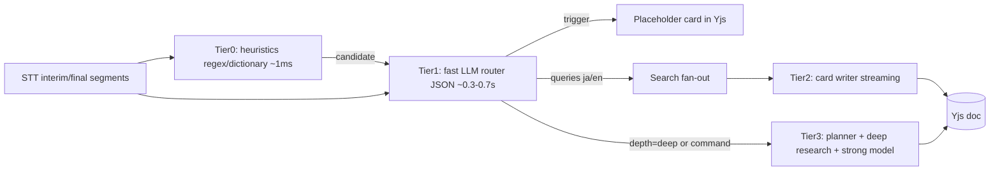
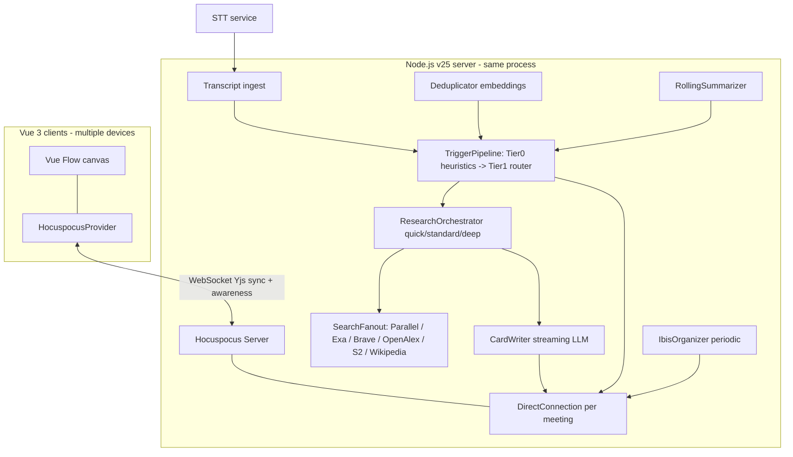
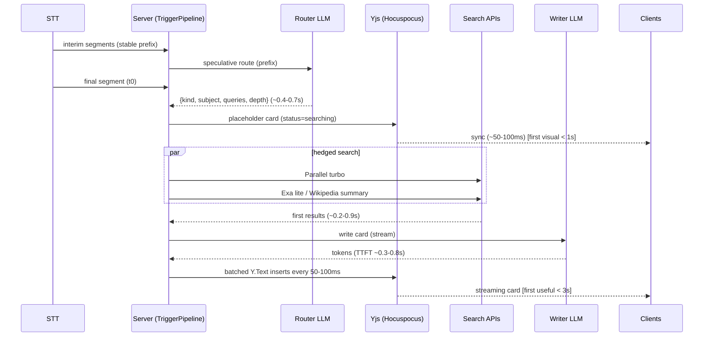

# 低レイテンシ LLM・検索 API・リアルタイム共同キャンバス スタック調査

- 調査日: 2026-10-27（Web 上の公式ドキュメント・npm レジストリ・一部実測で確認）
- 対象: EkklesiazousAI（会議の書き起こしストリームからトリガーを検出し、検索結果に基づくカードを共有無限キャンバスへ配信する）
- 表記ルール: 検証できなかった事項には **未確認** を付す。第三者や競合ベンダーの数値はその旨を明記する。Anthropic Claude の詳細は既存ドキュメントがあるため扱いは最小限にとどめる。

---

## 0. TL;DR（推奨構成）

| レイヤ | 推奨 | 代替・ヘッジ |
|---|---|---|
| トリガー検出ルーター（JSON・小出力） | **Cerebras `gpt-oss-120b`**（strict JSON Schema, 約 3,000 tok/s, first chunk 約 0.38 s） | **Groq `openai/gpt-oss-20b`**（約 1,000 tok/s, strict JSON）／**OpenAI `gpt-6-luna`**（`reasoning.effort: "none"`、日本語の安全策として並走させる） |
| カード執筆（日本語品質＋ストリーミング） | `claude-haiku-5-5` または **`gemini-3.5-flash-lite`**（thinking 既定 minimal, 約 419 tok/s） | Cerebras `qwen-3.8-27b`（約 1,850 tok/s, 日本語品質は **未確認**）、`gpt-6-luna` |
| 深掘りの統合・計画 | `claude-sonnet-5-5`／`claude-opus-5-5` | `gemini-3.8-flash`, `gpt-6.1-sol` |
| Web 検索（速度優先） | **Parallel Search API `mode: "turbo"`**（中央値約 200 ms、英語と日本語に対応と明記、$1/1k） | **Exa `type: "lite"`**（$4/1k、キャッシュのみ）、Brave LLM Context（p90 < 500 ms をベンダーが主張） |
| Web 検索（品質優先） | **Parallel `fast`/`basic`/`advanced`** ＋ **Exa `auto`/`deep-lite`/`deep`**（highlights 付き） | Perplexity Search API、Tavily `advanced` |
| 学術 | OpenAlex `/works?search=`（日本語論文もヒット、実測 0.7〜1.2 s）＋ Semantic Scholar `/graph/v1/paper/search`（API キー必須レベル） | arXiv API（3 秒間隔ルール） |
| 百科事典 | Wikipedia REST: `/w/rest.php/v1/search/title` → `/api/rest_v1/page/summary/{title}`（実測で各約 0.6 s） | — |
| 共同編集 | **Yjs 13.6.33 ＋ Hocuspocus 4.7.1**（`openDirectConnection` でサーバー内エージェントがピアとして書き込む） | `y-websocket@3.1.0` ＋ `@y/websocket-server@0.1.1`（**0.1.2 以降は yjs 14 プレリリースに依存するので注意**） |
| Vue キャンバス | **Vue Flow `@vue-flow/core@1.48.2`**（DOM ノード、ミニマップ、エッジ＝IBIS、`onlyRenderVisibleElements`） | `vue-konva@4.0.1`＋`konva@10.9.0`（描画が多い場合） |

レイテンシ予算（quick 経路の目安）: 最初の視覚フィードバックは発話確定から **約 0.8 s**（ルーター判定のあとプレースホルダカードを Yjs に書き込む）。最初の有用なトークンは **約 2.2 s**、カードの完成は **約 2.5〜3.0 s**。ストリーミング中の書き起こし（interim）で投機的に判定できた場合、プレースホルダは発話確定より前に出せる。詳細は §8。

---

## 1. 低レイテンシ LLM 推論（2026 年 10 月時点）

### 1.1 プロバイダ別モデル・価格・エンドポイント

| プロバイダ | 高速モデル（モデル ID） | 速度（公称または計測） | 価格（入力/出力, $/1M tok） | 構造化出力 | OpenAI 互換ベース URL |
|---|---|---|---|---|---|
| **Groq** | `openai/gpt-oss-20b` | 1,000 tok/s（公称）, AA 計測 898 tok/s, first chunk 0.71 s | 0.075 / 0.30 | strict `json_schema` 対応。**ただしストリーミングとツール併用は不可** | `https://api.groq.com/openai/v1` |
| | `openai/gpt-oss-120b` | 500 tok/s（公称）, AA 473 tok/s, first chunk 0.62 s | 0.15 / 0.60 | strict 対応 | 同上 |
| | `qwen/qwen3.8-27b`（Preview） | 450 tok/s（公称） | 0.80 / 4.00 | strict 対応 | 同上 |
| | `llama-3.1-8b-instant`, `llama-3.3-70b-versatile` | 560 / 280 tok/s | 「Contact Sales（Enterprise）」扱い | JSON object mode のみ | 同上 |
| **Cerebras** | `gpt-oss-120b` | 約 3,000 tok/s（公称）, AA 1,694 tok/s, first chunk **0.38 s** | 0.35 / 0.75（第三者による集計。公式ページからは取得できず **未確認**） | strict `json_schema`（`oneOf`、`pattern`、`minItems` などは非対応。スキーマ本文は 5,000 文字まで） | `https://api.cerebras.ai/v1`（`/chat/completions` を確認済み） |
| | `qwen-3.8-27b` | 約 1,850 tok/s（公称） | **未確認** | strict 対応 | 同上 |
| **SambaNova** | `gpt-oss-120b`, `DeepSeek-V3.1`, `Meta-Llama-3.3-70B-Instruct`（Production）。Preview に `MiniMax-M3`、`gemma-4-31B-it` | gpt-oss-120b: AA 700 tok/s, first chunk 1.15 s | **未確認** | **未確認** | `https://api.sambanova.ai/v1`（**未確認**） |
| **Google Gemini** | `gemini-3.5-flash-lite`（Stable） | AA 419 tok/s。AA の TTFT 8.31 s は reasoning 版の計測値。thinking=minimal での TTFT は **未確認** | 0.30 / 2.50（キャッシュ 0.03） | `response_format`（Interactions API）。**ストリーミング時は部分 JSON 文字列を連結すれば完全な JSON になる**と明記 | `https://generativelanguage.googleapis.com/v1beta/openai/` |
| | `gemini-3.1-flash-lite` | — | 0.25 / 1.50 | 同上 | 同上 |
| | `gemini-3.8-flash`（Stable, 最新 Flash） | AA 132 tok/s（high） | 2026-12-31 まで 0.75 / 3.75、2027-01-01 から 1.50 / 7.50 | 同上 | 同上 |
| **OpenAI** | `gpt-6-luna`（最小・最安の現行モデル） | AA（non-reasoning）120 tok/s, TTFT **0.93 s** | 0.10 / 0.50（キャッシュ読み 0.01） | Structured Outputs（strict）。ストリーミング対応 | `https://api.openai.com/v1` |
| | `gpt-5.6-luna`, `gpt-5.4-nano`, `gpt-5-nano` | gpt-5.4-nano は AA で deprecated 表記 | 0.20/1.20, 0.20/1.25, 0.05/0.40 | 同上 | 同上 |
| **Fireworks** | gpt-oss / Qwen 3.8 / DeepSeek V4 Flash など | **未確認** | gpt-oss-120b 0.15 / 0.60（第三者情報で **未確認**） | **未確認** | `https://api.fireworks.ai/inference/v1` |
| **Together** | gpt-oss / Qwen / Kimi / GLM / DeepSeek など | gpt-oss-120b: AA 169 tok/s, first chunk 0.48 s | **未確認** | `response_format` 対応（公式に記載あり） | `https://api.together.ai/v1` |

補足:
- AA（Artificial Analysis）の数値は直近 72 時間の中央値で、米国からの計測。日本から呼ぶ場合は RTT（往復遅延）が加わる（§8.4）。
- AA の「TTFT／time to first answer token」は推論トークンの生成時間を含む。ルーター用途では reasoning を `none` か `minimal` か `low` に落として**自分で計測すること**。
- **Groq** の Llama 系は Enterprise 限定に移り、公開の主力は gpt-oss の 2 モデル。8B クラスの超小型モデルは事実上使えない。
- **Cerebras** の公開カタログは 2 モデルだけで、改廃が激しい（GLM-4.7 は 2026-08 に deprecation された）。フォールバック先を必ず用意すること。無料枠は $5 のプロモクレジット（30 日）だけ。
- **Gemini** は Interactions API（`POST /v1beta/interactions`）が新規開発での推奨。`generateContent` は「legacy だが fully supported」。
- **Gemini の thinking** 設定: `gemini-3.5-flash-lite` は既定 `minimal`（minimal/low/medium/high）。`gemini-3.8-flash` は low/medium/high のみで、minimal は選べない。OpenAI 互換レイヤでは Gemini 3 系の reasoning を off にできない。
- **OpenAI Fast mode**（旧 priority processing。2026-07-30 に改称）: `service_tier: "priority"` または `"fast"` を指定すると最大 2.5 倍速、料金は 2 倍。`gpt-6-luna` の Chat Completions で function calling を使えるのは `reasoning_effort: "none"` のときだけ。
- **Perplexity Sonar**（chat/completions）は 2026-09-27 に退役予定と報じられ、Agent API へ移行中（§3.5）。

### 1.2 用途別の評価

| 用途 | 要件 | 適任 | コメント |
|---|---|---|---|
| ルーター／トリガー検出 | TTFT 300 ms 未満、出力 30〜80 tokens の JSON、日本語理解 | Cerebras gpt-oss-120b, Groq gpt-oss-20b, gpt-6-luna(none) | Groq は structured outputs を streaming できないが、ルーターは非ストリームで十分。gpt-oss の日本語会話理解の精度は **未確認**。評価セット（日本語発話 50〜100 件）で F1 を測る |
| カード執筆 | 日本語の自然さ、ストリーミング、120〜250 tokens | claude-haiku-5-5, gemini-3.5-flash-lite, gpt-6-luna(low/none), Cerebras qwen-3.8-27b | 速度は Cerebras が圧倒的。日本語品質は Claude・Gemini・OpenAI が安全側 |
| 深掘り統合 | 品質優先、15〜40 s 許容 | claude-sonnet-5-5 / opus-5-5, gemini-3.8-flash | 進捗をストリーミング表示する |
| IBIS 整理（定期） | 中品質、長文脈、非同期 | gemini-3.8-flash, claude-sonnet-5-5 | プロンプトキャッシュが効く構成にする（§2.5） |

### 1.3 実装メモ（fetch で直接叩く場合）

```ts
// Router call to Cerebras (OpenAI-compatible). Strict JSON Schema; no streaming needed.
const TRIGGER_SCHEMA = {
  type: "object",
  additionalProperties: false,
  properties: {
    triggers: {
      type: "array",
      items: {
        type: "object",
        additionalProperties: false,
        properties: {
          kind: { type: "string", enum: ["prior_art", "catch_up", "fact_check", "devil", "command", "none"] },
          subject: { type: "string" },
          queryJa: { type: "string" },
          queryEn: { type: "string" },
          depth: { type: "string", enum: ["quick", "standard", "deep"] },
          confidence: { type: "number" },
        },
        required: ["kind", "subject", "queryJa", "queryEn", "depth", "confidence"],
      },
    },
  },
  required: ["triggers"],
} as const;

const res = await fetch("https://api.cerebras.ai/v1/chat/completions", {
  method: "POST",
  headers: { "Content-Type": "application/json", Authorization: `Bearer ${process.env.CEREBRAS_API_KEY}` },
  body: JSON.stringify({
    model: "gpt-oss-120b",
    messages: [
      { role: "system", content: ROUTER_SYSTEM_PROMPT }, // stable prefix first (cache-friendly)
      { role: "user", content: recentWindowText },
    ],
    response_format: { type: "json_schema", json_schema: { name: "trigger", strict: true, schema: TRIGGER_SCHEMA } },
    reasoning_effort: "low", // gpt-oss reasoning control on Cerebras: 未確認 (verify)
    max_completion_tokens: 300, // parameter name on Cerebras: 未確認 (max_tokens may be required)
  }),
  signal, // AbortSignal for cancellation
});
```

```ts
// Router hedge on OpenAI Responses API (gpt-6-luna without reasoning, Fast mode).
await fetch("https://api.openai.com/v1/responses", {
  method: "POST",
  headers: { "Content-Type": "application/json", Authorization: `Bearer ${process.env.OPENAI_API_KEY}` },
  body: JSON.stringify({
    model: "gpt-6-luna",
    reasoning: { effort: "none" },
    service_tier: "priority",
    input: [
      { role: "system", content: ROUTER_SYSTEM_PROMPT },
      { role: "user", content: recentWindowText },
    ],
    text: { format: { type: "json_schema", name: "trigger", strict: true, schema: TRIGGER_SCHEMA } },
    max_output_tokens: 300,
    prompt_cache_key: meetingId, // optional on GPT-5.6+; useful for per-meeting cache accounting
  }),
  signal,
});
```

```ts
// Card writer streaming partial objects with Vercel AI SDK v7 (ai@7.0.153).
import { streamText, Output } from "ai";
import { z } from "zod";

const CardSchema = z.object({ title: z.string(), bullets: z.array(z.string()), sources: z.array(z.string()) });
const result = streamText({
  model, // e.g. google("gemini-3.5-flash-lite") / cerebras("qwen-3.8-27b") / anthropic("claude-haiku-5-5")
  output: Output.object({ schema: CardSchema }),
  prompt,
  abortSignal: signal, // call option name in v7: 要確認
});
for await (const partial of result.partialOutputStream) {
  cardWriter.applyPartial(cardId, partial); // throttle Yjs writes to ~50-100 ms
}
```

関連 npm（2026-10-27 時点の最新版）: `ai@7.0.153`, `@ai-sdk/openai@4.0.102`, `@ai-sdk/google@4.0.105`, `@ai-sdk/groq@4.0.70`, `@ai-sdk/cerebras@3.0.78`, `@ai-sdk/openai-compatible@3.0.78`, `openai@7.44.0`, `@google/genai@2.31.0`, `groq-sdk@1.6.0`, `@cerebras/cerebras_cloud_sdk@1.91.0`, `zod@4.6.7`。AI SDK v7 の公式ドキュメントで構造化ストリーミングとして示されているのは `streamText({ output: Output.object(...) })` と `partialOutputStream`（`streamObject` への言及はない）。

---

## 2. ライブ会話向け LLM パイプラインのレイテンシ設計パターン

### 2.1 多段トリガー（Two-tier をさらに分割）



- **Tier 0（ヒューリスティック）**: 日本語・英語の手掛かり語辞書で候補を拾う。例: 「〜を作りたい」「〜作れば」「既存の」→ prior_art。「〜って何」「論文」「〇〇効果」、カタカナ専門語、英字略語 → catch_up。数値・割合・「によると」「〜らしい」→ fact_check。ウェイクフレーズや「調べて」→ command。この層は LLM を呼ぶかどうかの判断と**優先度付け**に使い、取りこぼしは Tier 1 の定期実行で救う。
- **Tier 1（ルーター）**: 直近の書き起こしウィンドウ（30〜90 秒）＋ローリング要約＋既出用語リストを入力し、`triggers[]` を JSON で返す。出力を短く保つことが最大の効果を生む（OpenAI のガイドによれば、出力トークンを 50% 減らすとレイテンシもほぼ 50% 減る。プロンプトを 50% 減らしても改善は 1〜5% 程度）。
- **Tier 2（カード執筆）**: 検索結果を受けてストリーミングする。
- **Tier 3（深掘り）**: 明示コマンドか `depth=deep` の場合だけ起動する（§4）。

### 2.2 発話終了のデバウンスと投機実行

- **発話終了の判定**: STT の final セグメントを主なトリガーにする。VAD（音声区間検出）だけで判定すると誤カットが増える。音声エージェント分野では Pipecat Smart Turn v3（既定のターン終了判定）や LiveKit の turn detector が使われている。LiveKit の既定 min endpointing delay は 0.5 s で、ターン判定の遅延の大半はここから来るとコミュニティで説明されている。本プロジェクトは「割り込み応答」ではなく「横で表示する」だけなので、誤検出のコストは低い。**攻めた設定にしてよい**。
- **投機実行（speculative execution）**: interim の書き起こしが 250〜400 ms 変化しなくなった時点で、その prefix に対してルーターを走らせる。final が届いたら差分を確認し、意味が変わらなければ結果を確定する。変わった場合は AbortController で破棄する。LiveKit Agents の preemptive generation（ターン確定前に LLM を走らせ、文脈が変われば破棄して再生成する）が同じ発想の先行事例。トークン消費が増えるので、長い発話（目安 10 s 超）ではスキップする。
- **検索の投機**: ルーターの `confidence` がしきい値（例 0.8）を超えたら final を待たずに quick 検索を開始する。検索は 1 回 $0.001〜0.005 程度なので、空振りを許容したほうが体感速度に効く。

### 2.3 部分 JSON のストリーミングと UI

- 方式 A: AI SDK の `partialOutputStream`。部分オブジェクトを Yjs のカードフィールドへ反映する。
- 方式 B: Gemini の streaming structured output。チャンクを連結すれば完全な JSON になる。部分パースには `@streamparser/json@0.0.26` などを使う（`partial-json@0.1.7` は 2024 年以降更新がない）。
- 方式 C（最速・最単純）: JSON をやめ、行指向のフォーマット（`TITLE: ...\n- bullet\n- bullet\nSRC: [1][2]`）でストリーミングし、サーバー側で行単位にパースする。Groq のように structured outputs をストリーミングできない環境では C を選ぶ。
- Yjs への書き込みは**トークンごとではなく 50〜100 ms ごとにまとめる**。CRDT の更新回数とネットワークのファンアウトを抑えられる。本文は `Y.Text` に差分を insert する。

### 2.4 キャンセルと世代管理

- トリガー 1 件ごとに `AbortController` を 1 つ持たせ、LLM・検索のすべての `fetch(..., { signal })` に渡す。
- 同じ subject の新しいトリガーが来たら古いものを abort する（世代番号を使う）。カードは「更新」に切り替える。
- 中断したリクエストが課金されるかどうかは各社とも **未確認**。課金される前提で投機の閾値を決める。

### 2.5 プロンプトキャッシュ

| プロバイダ | 方式 | 最小トークン | TTL | 価格 | 確認用フィールド |
|---|---|---|---|---|---|
| OpenAI（GPT-5.6 以降、gpt-6-luna を含む） | 自動（implicit：最新メッセージ末尾にブレークポイント）。`prompt_cache_breakpoint` による explicit も可 | 1,024 | `prompt_cache_options.ttl`: `"30m"`（既定）/`"12h"` | 書き込み 1.25 倍（12h は 2.5 倍）、読み 0.1 倍 | `usage.input_tokens_details.cached_tokens`, `cache_write_tokens` |
| OpenAI（それ以前のモデル） | 自動。`prompt_cache_key` でルーティングを補助 | モデル依存 | `prompt_cache_retention`: `in_memory`/`24h` | — | 同上 |
| Gemini | **implicit（2.5 以降は既定で有効）**。explicit cache は generateContent で利用可（Interactions API と Gemini 4 Argon 以降は非対応） | 3.x Flash: 4,096。Flash-Lite の値は **未確認** | 明示なし | キャッシュ入力は通常入力の約 1/10（3.5 Flash-Lite は 0.03 vs 0.30） | `usage.total_cached_tokens` |
| Groq / Cerebras | **未確認** | — | — | — | — |

設計指針（共通）: **固定部分を先頭に置く**。順序は「システムプロンプト → スキーマ・ツール定義 → 会議メタデータ（議題・参加者）→ ローリング要約（数十秒ごとにしか変えない）→ 直近ウィンドウ（毎回変わる）」。Gemini は 4,096 tokens 以上でないと implicit cache が効かないので、ルーター用の短いプロンプトでは恩恵がない。キャッシュが効くのはカード執筆と IBIS 整理の側。

### 2.6 ローリング要約とコンテキスト構成

- `recentWindow`: 直近 60〜90 s の生書き起こし（話者ラベル付き）。
- `rollingSummary`: 60 s ごと、または 20 発話ごとに背景で更新する（Flash 級のモデルで十分）。
- `termRegistry`: 説明済みの用語、検索済みのクエリとカード ID の一覧。重複抑止とルーターへの「既出」ヒントに使う。
- `ibisState`: 論点・立場・論拠の構造。IBIS 更新ジョブだけが読み書きする。

### 2.7 並列ファンアウトとヘッジ

- `Promise.allSettled` で複数ソースへ同時に投げ、**ソースごとにタイムアウト**を設定する（quick: 1.2 s、standard: 2.5 s）。期限までに返ったものだけで執筆を開始し、遅れて届いた結果はカードの「追記」として扱う。
- ヘッジ: quick 検索は 2 社（例: Parallel turbo と Exa lite）へ同時に投げ、先に返った方を使う。コストは約 2 倍だが p95 が大きく下がる。
- HTTP keep-alive（Node の fetch／undici は既定で有効）を使い、会議の開始時に各 API へ軽いリクエストを送って TLS 接続を温めておく（プリウォーム）。

### 2.8 埋め込みによる意味的重複排除

| モデル | 価格（$/1M tok） | 備考 |
|---|---|---|
| OpenAI `text-embedding-3-small` | 0.02 | 2026-10 時点でも現行。レイテンシの公式値はない（**未確認**） |
| Voyage `voyage-4-lite` | 0.02（第三者の集計で **未確認**） | 「latency と cost に最適化」と公式に記載。`POST https://api.voyageai.com/v1/embeddings`。次元は 256/512/1024/2048 を選べる |
| Gemini `gemini-embedding-2-preview` | 0.20（テキスト） | マルチモーダル |
| Cohere `embed-v4.0` | **未確認** | 100 以上の言語に対応 |
| ローカル（`@huggingface/transformers@4.3.1` で多言語小型モデル） | 0 | ネットワーク往復がなく CPU で数十 ms 程度と見込む（**未確認**、モデル選定も要評価） |

重複判定のロジック: ① `(kind, 正規化 subject)` の完全一致 → ② 直近 N 分のカードとコサイン類似度を比較し、0.85〜0.9 を超えたら新規作成せず既存カードを更新する。外部 API の往復（日本から米国へ 100 ms 以上）を避けたいなら、ローカル埋め込みが有利。

### 2.9 公開された計測・事例

- **LiveFC**（arXiv 2408.07448）: 音声ストリームのライブファクトチェック。Whisper large-v3 ＋オンライン話者分離 → 文分割 → Mistral-7B で正規化 → **ファインチューニングした XLM-RoBERTa で check-worthy 判定**（macro-F1 0.899。LLM ベースラインは 0.59〜0.70）→ 検索 → NLI で判定、という構成。「数秒以内」とあるだけで、段階別のレイテンシは示されていない。**主張検出は小型分類器のほうが LLM より高精度**という示唆は、Tier 0〜1 の設計に役立つ。
- **OpenAI Latency optimization ガイド**: 7 原則（小さいモデル、出力削減、入力削減、リクエスト数削減、並列化と投機、ストリーミング、LLM を使わない）。
- **検索 API の遅延**（§3.2）: openbenchmarks（2026-09）、Parallel 社の比較（競合ベンダー）、Serverworks の実測（2026-04、英語クエリ）。
- **LiveKit preemptive generation、Pipecat Smart Turn**: ターン確定前の投機生成と、ターン終了判定モデルの事例。

---

## 3. 検索 API

### 3.1 Web 検索 API 比較

| API | エンドポイント | 認証 | 速度モード・遅延 | 価格 | 備考 |
|---|---|---|---|---|---|
| **Parallel Search** | `POST https://api.parallel.ai/v1/search` | `x-api-key` | `turbo` 約 200 ms、`fast` 約 700 ms、`basic` 約 1 s、`advanced` 約 3 s（既定） | turbo/fast $1/1k、basic/advanced $5/1k | **turbo は英語と日本語のクエリに対応と明記**。結果は LLM 向けの excerpts |
| **Exa** | `POST https://api.exa.ai/search` | `x-api-key` または `Authorization: Bearer` | `lite`（2026-10-19 追加。キャッシュのみ、低遅延。公称 ms は **未確認**）、`auto`（既定）、`deep-lite`（一定して約 4 s）、`deep`（4〜15 s）。旧 `instant`（150 ms 未満）と `fast`（p50 425 ms 未満）は legacy | lite $4/1k、auto $7/1k、deep 系 $12/1k、contents は種類ごとに $1/1k pages | highlights、summary、`outputSchema`＋SSE |
| **Tavily** | `POST https://api.tavily.com/search` | `Authorization: Bearer tvly-...` | `search_depth`: `ultra-fast`、`fast`、`basic`（既定）、`advanced` | basic/fast/ultra-fast 1 credit、advanced 2 credits | `country`、`language`、`include_raw_content`、`chunks_per_source` |
| **Perplexity Search** | `POST https://api.perplexity.ai/search` | `Authorization: Bearer` | `search_type`: `web`（既定）/`fast` | web $5/1k、fast $1/1k（1 リクエストで最大 5 クエリまで 1 課金） | `search_language_filter`（ISO 639-1、最大 20）、`country` |
| **Perplexity Agent API** | `POST https://api.perplexity.ai/v1/agent`（`/v1/responses` は互換エイリアス） | `Authorization: Bearer` | `effort`: fast/low/medium/high/xhigh（§4） | トークン課金＋ツール料金（web_search $0.0025、fast は $0.001） | 旧 Sonar chat/completions の後継 |
| **Brave Search** | `GET https://api.search.brave.com/res/v1/web/search` | `X-Subscription-Token` | Web 検索 約 521 ms（Serverworks 実測、英語）。LLM Context は p90 < 500 ms（Brave の主張）、Serverworks 実測では約 687 ms | Search プラン $5/1k（LLM Context 込み）、毎月 $5 分の無料クレジット | 独立インデックス。`country`、`search_lang`、`freshness`、`extra_snippets`。LLM Context のパスは **未確認**（docs: `/documentation/services/llm-context`） |
| Serper | `https://google.serper.dev/search`（**未確認**） | `X-API-KEY`（**未確認**） | 「1〜2 秒」（自称） | 2,500 クエリ無料 | Google SERP の生データ |
| Gemini Grounding | Interactions API の `tools: [{"type":"google_search"}]` | `x-goog-api-key` | LLM 生成込みなので遅い | Gemini 3 以降: 月 5,000 クエリ無料、超過分は $14/1k | Google の索引なので日本語は強いと見込む（**未確認**）。Search Suggestions の表示義務は ToS 側で規定 |
| OpenAI web_search | Responses API の `tools: [{"type":"web_search"}]` | Bearer | non-reasoning は速い、agentic（reasoning）は遅い | $10/1k calls ＋検索コンテンツのトークン | `url_citation` 注釈。Chat Completions では `gpt-5-search-api` |
| Jina | `s.jina.ai`（検索）/`r.jina.ai`（リーダー） | Bearer | 検索 平均 2.5 s、リーダー 平均 7.9 s（第三者） | — | 2026-02 に r.jina.ai の劣化インシデントが複数あった。リアルタイム用途には不向き |

### 3.2 公開ベンチマーク（いずれも外部計測。日本語は含まない）

| 計測 | 結果 |
|---|---|
| openbenchmarks 平均遅延（2026-09, factual lookup） | Parallel Turbo 348 ms、Exa Instant 398 ms、Brave 601〜630 ms、Parallel Fast 942 ms、Perplexity(low) 1.38 s、Tavily Basic 1.88 s |
| Parallel 社の精度比較（2026-09-09。Parallel は競合ベンダー） | BrowseComp（frontier/low-cost）: Parallel 74/44、Perplexity 74/46、Exa(Auto) 70/36、Tavily 66/32。SimpleQA Verified ではどれも 91〜97% |
| Artificial Analysis Search Index（2026-09） | Perplexity 80、Octen 77、Parallel Advanced 75、Brave LLM context 75、You.com 74、Exa Auto 74 |
| Parallel 社の計測（Tavily Ultra Fast） | p50 240〜357 ms。ただし BrowseComp の精度は 19.3% |
| Serverworks（2026-04, 英語 5 クエリ × 10 回） | Brave 521 ms、Tavily basic 806 ms、advanced 991 ms、Brave LLM Context 687 ms。公式ソースが上位に入る率は Brave 40%、Tavily basic 28% |

### 3.3 推奨 1: Parallel Search API（詳細）

```ts
// POST https://api.parallel.ai/v1/search  (header: x-api-key). Unknown fields are rejected (additionalProperties=false).
const res = await fetch("https://api.parallel.ai/v1/search", {
  method: "POST",
  headers: { "Content-Type": "application/json", "x-api-key": process.env.PARALLEL_API_KEY! },
  body: JSON.stringify({
    mode: "turbo",                       // "turbo" | "fast" | "basic" | "advanced"(default)
    objective: "会議で言及された『◯◯』の概要と代表的な既存事例を知りたい", // self-contained goal
    search_queries: ["◯◯ とは", "◯◯ overview"], // REQUIRED, 3-6 words each, 2-3 recommended
    max_chars_total: 6000,
    client_model: "claude-haiku-5-5",
    advanced_settings: {
      max_results: 5,
      location: "jp",                    // ISO 3166-1 alpha-2
      excerpt_settings: { max_chars_per_result: 1200 },
      source_policy: { exclude_domains: [], after_date: "2024-01-01" },
      // fetch_policy: { max_age_seconds: 600, timeout_seconds: 3, disable_cache_fallback: false } // live fetch increases latency
    },
  }),
  signal,
});
// Response 200:
// { search_id: string, session_id: string,
//   results: Array<{ url: string, title: string|null, publish_date: string|null /*YYYY-MM-DD*/, excerpts: string[] /*markdown*/ }>,
//   warnings: Array<{ type, message, detail }>|null, usage: Array<{ name: string, count: number }>|null }
// Error 422: { type: "error", error: { ref_id, message, detail } }
```

- `session_id` を、同じトリガー内の続く search/extract 呼び出しに引き継げる。
- EU エンドポイント（`https://eu.parallel.ai`）は `basic` だけ対応。
- 深掘り向けの Task API（`lite` で p50 45 s、`base` で 50 s）は **deep tier（〜40 s）にも遅すぎる**。公式も「低遅延なら Task API ではなく Responses API を」と案内している。

### 3.4 推奨 2: Exa（詳細）

```ts
// POST https://api.exa.ai/search  (header: x-api-key  or  Authorization: Bearer)
const res = await fetch("https://api.exa.ai/search", {
  method: "POST",
  headers: { "Content-Type": "application/json", "x-api-key": process.env.EXA_API_KEY! },
  body: JSON.stringify({
    query: "retrieval augmented generation meeting assistant",
    type: "auto",                         // "lite" | "auto"(default) | "deep-lite" | "deep"
    numResults: 5,                        // 1-100 (limits vary by type)
    userLocation: "JP",
    // category: "publication" | "news" | "company" | "personal site" | "financial report" | "people"
    // includeDomains / excludeDomains, startPublishedDate / endPublishedDate (ISO 8601)
    contents: {
      highlights: { maxCharacters: 600, query: "key facts" }, // highlights.query optional
      // text: { maxCharacters: 4000, verbosity: "compact" },
      // summary: { query: "...", schema: {...} },
      maxAgeHours: -1,                    // -1 = always cache (fastest), 0 = always live
    },
  }),
  signal,
});
// Response: { requestId, searchTime /*ms*/, costDollars: { total, ... },
//   results: Array<{ id, url, title, publishedDate, author, image, favicon,
//                    text?, highlights?: string[], highlightScores?: number[], summary? }>,
//   warnings?, notices?, output? /* only with outputSchema: { content, grounding } */ }
```

- `lite` は受け付けるパラメータが限られ、未対応のパラメータを渡すと 400 になる。`lite` で `contents.highlights` が使えるかどうかは **未確認**（使えない場合は auto を使うか、`/contents` を後から呼ぶ）。
- `outputSchema` を付けると合成結果を `stream: true`（SSE: `text-delta`/`grounding`/`results`/`done`）で受け取れる。遅延は約 2 s 増える。
- `/contents` エンドポイントの `id` は検索結果の `id` を使う。`/contents` のリクエストフィールド名（`ids`/`urls`）は **未確認**。
- `category: "publication"` は学術 3.5 億件をカバーし、Semantic Scholar の代替になりうる。

### 3.5 その他の詳細

**Tavily**（`POST https://api.tavily.com/search`、Bearer）
- リクエスト: `query`（必須）、`search_depth`（`advanced`|`basic`|`fast`|`ultra-fast`）、`max_results`（0〜20）、`topic`（`general`|`news`|`finance`）、`time_range`、`start_date`/`end_date`、`include_answer`、`include_raw_content`（`markdown`|`text`）、`chunks_per_source`（1〜3）、`include_domains`/`exclude_domains`、`country`、`language`、`filter_by_language`、`auto_parameters`（2 credits）、`exact_match`、`include_usage`。
- レスポンス: `query`、`answer`、`results[]{title,url,content,score,raw_content,published_date,favicon,images,id}`、`response_time`（秒）、`usage`、`request_id`。
- 深掘り用に `POST https://api.tavily.com/research`（`input`、`model: "mini"|"pro"|"auto"`、`stream`、`output_schema`、`output_length`）がある。完了までの時間とポーリング方法は **未確認**。

**Perplexity Search API**（`POST https://api.perplexity.ai/search`、Bearer）
- リクエスト: `query`（文字列または配列）、`max_results`（web は最大 20）、`search_type`（`web`|`fast`|`people`）、`max_tokens`、`max_tokens_per_page`、`country`、`search_language_filter`（例 `["ja","en"]`）、`search_domain_filter`、`search_recency_filter`（`hour`〜`year`）、日付フィルタ（MM/DD/YYYY）。
- レスポンス: `id`、`results[]{title,url,snippet,date,last_updated}`、`server_time`。

**Perplexity Agent API**（`POST https://api.perplexity.ai/v1/agent`）
- `effort` レベル: `fast`（gpt-6-luna、web_search fast 10 件、1 step、reasoning none、priority tier）、`low`（gpt-6-luna、5 steps、fetch_url）、`medium`（gpt-6-luna、15 steps）、`high`（gpt-6-sol、15 steps）、`xhigh`（claude-opus-5-5、100 steps、sandbox）。`fast@2026-10-16.0` のように日付を付けてバージョンを固定できる。
- 旧 Sonar chat/completions は 2026-09-27 に退役予定と報じられた（第三者情報。公式の移行ガイドとの食い違いも指摘されており **未確認**）。対応のおおよその目安は sonar → `fast`、sonar-pro → `low`/`medium`、sonar-deep-research → `high`/`xhigh`（**未確認**の近似）。
- レスポンス: `output[]` に `search_results{queries, results[{title,url,snippet,date,last_updated}]}` と `message`（`output_text`）が入る。本文中のインライン引用は `[web:1]` 形式。`usage.cost` が付く。

**Gemini Grounding（Interactions API）**: `tools: [{"type":"google_search"}]`。レスポンスに `google_search_call`（`arguments.queries`）、`google_search_result`（`search_suggestions` HTML）、`model_output` の `url_citation`（`url`、`title`、`start_index`、`end_index`）が入る。`generateContent` 側の `tools: [{google_search:{}}]` と `groundingMetadata` の形式は旧ドキュメント由来で、現行仕様は **未確認**。

**OpenAI web_search（Responses API）**: `tools: [{ type: "web_search", search_context_size: "low", user_location: { type: "approximate", country: "JP" }, filters: { allowed_domains: [...] } }]`。`user_location` の `type` 指定は **未確認**。全参照 URL は `include: ["web_search_call.action.sources"]` で得られる。`url_citation` は UI 上でクリック可能な形で表示する義務がある。

### 3.6 学術 API（この端末から実測）

**Semantic Scholar Graph API**（swagger.json で確認）
```
GET https://api.semanticscholar.org/graph/v1/paper/search
    ?query=retrieval+augmented+generation
    &fields=title,year,url,tldr,citationCount,externalIds,abstract,authors,openAccessPdf,publicationDate,venue
    &limit=5&year=2023-&fieldsOfStudy=Computer Science
Header: x-api-key: <key>   (case-sensitive)
Response: { total, offset, next, data: [ { paperId, title, year, url, tldr: { model, text }, citationCount, externalIds, ... } ] }
```
- パラメータ: `query`、`fields`、`publicationTypes`、`openAccessPdf`、`minCitationCount`、`publicationDateOrYear`、`year`、`venue`、`fieldsOfStudy`、`offset`、`limit`。relevance 検索は最大 1,000 件まで。
- 指定できる fields: `paperId, corpusId, externalIds, url, title, abstract, venue, publicationVenue, year, referenceCount, citationCount, influentialCitationCount, isOpenAccess, openAccessPdf, fieldsOfStudy, s2FieldsOfStudy, publicationTypes, publicationDate, journal, citationStyles, authors, citations, references, embedding, tldr, textAvailability`。
- その他のエンドポイント: `/paper/search/match`（タイトルの最近傍 1 件。論文名が会話に出たときに使う）、`/snippet/search`（本文から約 500 語の断片を返す。fact check の根拠に使える）、`/paper/search/bulk`（1 回 1,000 件、token でページング）。
- **注意: クエリ中のハイフン付きの語はヒットしない**（スペースに置き換える）。
- レート制限: キーなしは「未認証ユーザー全体で共有する 1,000 rps」。キーありの初期値は 1 RPS。**実測（2026-10-27）ではキーなしで 3 回中 2 回が 429、成功時は 1.3 s**。本番ではキーを取得し、1 RPS のキューを組むことが必須。

**OpenAlex**
```
GET https://api.openalex.org/works?search=<query>&per_page=5
    &select=id,display_name,publication_year,doi,cited_by_count,language,primary_location,open_access
    &api_key=<key>        (or Authorization: Bearer <key>)
Response: { meta: { count, db_response_time_ms, cost_usd, ... }, results: [ { id, display_name, publication_year, doi, cited_by_count, language, primary_location, open_access } ] }
```
- `search=`（タイトル・抄録・全文）、`search.title`、`search.title_and_abstract`、`search.exact`、`search.semantic`（1 rps、他の検索パラメータとは併用不可）、`rerank=true`（上位 100 件を並べ替え、+10 credits）。
- レート制限: キーなし 10 rps、無料キー 30 rps。日次予算はキーなしだと **IP 単位で共有の $0.10/日**、無料キーで $1/日（実測レスポンスの notice より）。1 検索あたり `cost_usd: 0.001` を観測した。従来の「polite pool（mailto）」は現行ドキュメントに記載がなく、キー方式に移行したとみられる（**未確認**）。
- **実測**: 英語クエリで 0.67〜1.25 s。日本語クエリ「大規模言語モデル」で `language: "ja"` の論文（IRDB、IEICE 経由）がヒットした。**日本語の学術ソースに強い**。

**arXiv API**
```
GET https://export.arxiv.org/api/query?search_query=all:%22retrieval%20augmented%20generation%22&start=0&max_results=5&sortBy=relevance&sortOrder=descending
→ Atom XML: <entry><id/><title/><summary/><published/><updated/><author><name/></author><link rel="alternate"/><link title="pdf"/><arxiv:primary_category/></entry>
```
- フィールド接頭辞: `ti`、`au`、`abs`、`all`、`cat` ほか。演算子は `AND`、`OR`、`ANDNOT`。**連続呼び出しは約 3 秒空ける**よう求められており、結果は 1 日 1 回しか変わらないのでキャッシュ推奨。実測 0.58 s。

### 3.7 百科事典（Wikipedia REST、実測）

```
GET https://ja.wikipedia.org/w/rest.php/v1/search/title?q=大規模言語&limit=3     → 0.57 s, pages[{ key, title, description }]
GET https://ja.wikipedia.org/api/rest_v1/page/summary/{title}                     → 0.56 s, { title, description, extract, content_urls, ... }
```
- 全文検索 `/w/rest.php/v1/search/page?q=大規模言語モデル` は 1 位に「マークアップ言語」が返り、**順位付けが悪かった**。ルーターに正規化した見出し語を出させ、title 検索 → summary の 2 段で引く。
- Wikimedia の方針に従い、連絡先入りの `User-Agent` を付ける（方針の詳細は **未確認**）。en/ja を並列に引き、catch-up カードの「1 行定義」を最速で埋める用途に向く。

### 3.8 日本語品質のメモ

- 日本語クエリで Web 検索 API を直接比べた信頼できる公開データは**見つからなかった**（**未確認**）。Serverworks の比較も英語クエリだけ。
- 判断材料: Parallel turbo は日本語対応を明記。Brave は `country=JP`、`search_lang=ja` などロケール指定が充実した独立インデックス。Perplexity は `search_language_filter`、Tavily は `country`/`language`、Exa は `userLocation` を持つ。Gemini Grounding は Google の索引なので日本語は強いと見込む（**未確認**）。
- **やること**: 実際の会議を想定した日本語クエリ 30〜50 件（技術用語、国内事例、統計値）で、Parallel turbo/fast、Exa lite/auto、Brave、Perplexity fast の 4〜6 系統を、nDCG@5 相当の手動評価と p50/p95 遅延で比べる。

---

## 4. 調査深度ティアと API・パラメータの対応（明示コマンド＋自動トリガー）

起動経路: (a) 自動トリガーは既定で `quick`（prior_art と fact_check は `standard` に昇格可能）。(b) 参加者がテキストまたは音声のウェイクフレーズで明示的に指示した場合は、ルーターが `kind: "command"` と `depth` を抽出する（「ざっと」→ quick、「調べて」→ standard、「詳しく」「深掘り」→ deep）。カード上の UI からも深度を変更でき、変更すると再実行する。

| ティア | 目標 | 処理 | 検索 API・パラメータ | LLM | 想定レイテンシ |
|---|---|---|---|---|---|
| **quick** | < 3 s | クエリ 1 本（ルーター出力をそのまま使う）、最速検索、短いカード | **Parallel** `mode:"turbo"`, `max_results:5`, `excerpt_settings.max_chars_per_result:800`。ヘッジ先に **Exa** `type:"lite"`, `numResults:5`（highlights は lite で使えれば `maxCharacters:500`）、または Perplexity Search `search_type:"fast"`、Tavily `search_depth:"ultra-fast"`, `max_results:5`。catch-up の場合は Wikipedia の title→summary を並列で引く | ルーター: Cerebras gpt-oss-120b。執筆: gemini-3.5-flash-lite / claude-haiku-5-5 / Cerebras qwen-3.8-27b（出力 120 tokens 以下） | プレースホルダ 0.5〜0.9 s、検索 0.2〜0.9 s、最初の本文 1.6〜2.3 s、完成 2.0〜3.0 s |
| **standard** | 4〜6 s | 日英バイリンガルのクエリ（ja 1〜2 本、en 1〜2 本）。Web、学術、百科事典へのファンアウト。重複排除と簡易リランク | **Parallel** `mode:"fast"`, `search_queries:[ja, en]`, `max_results:8`。**Exa** `type:"auto"`, `numResults:8`, `contents.highlights.maxCharacters:800`（学術寄りなら `category:"publication"`）。**OpenAlex** `search=`（ja/en）、**Semantic Scholar** `/paper/search`（`fields=title,year,url,tldr,citationCount`, `limit=5`, 1 RPS キュー）、**Wikipedia** ja/en summary。ソースごとのタイムアウトは 2.5 s | 執筆: claude-haiku-5-5 / gemini-3.5-flash-lite（thinking low）。出典番号付き 200〜300 tokens | 検索 0.7〜2.5 s、最初の本文 3〜4 s、完成 4〜6 s |
| **deep** | 15〜40 s（進捗を表示） | LLM でクエリを計画し 3〜5 本のサブクエリに分ける（ja/en、学術）。並列検索 → 上位 URL の本文・ハイライト取得 → 強いモデルで統合 | 計画: claude-sonnet-5-5 または gpt-6-luna(low)。検索: **Parallel** `mode:"basic"`（約 1 s）か `"advanced"`（約 3 s）をサブクエリごとに。**Exa** `type:"deep-lite"`（約 4 s）か `"deep"`（4〜15 s）に `additionalQueries`、`outputSchema` と `stream:true` を付ける。本文は Exa `contents.text.maxCharacters:4000` か `/contents`。**Semantic Scholar** `/snippet/search`（本文の根拠）、`/paper/search/match`（論文名の同定）。OpenAlex `search.semantic`。マネージド型の代替は **Perplexity Agent API** `effort:"low"` か `"medium"`（遅延は **未確認**）、**Tavily** `/research` `model:"mini"`, `stream:true`（遅延は **未確認**） | 統合: claude-sonnet-5-5 / claude-opus-5-5（ストリーミング） | 計画 1〜2 s、検索 3〜15 s、読み込み 2〜5 s、統合 5〜15 s、合計 15〜35 s |

deep に**向かない**もの: Parallel Task API（lite で p50 45 s、p90 1.5 min）、Gemini Deep Research（`deep-research-preview-04-2026`）、OpenAI のディープリサーチ（gpt-5.5 の high/xhigh を background モードで実行）。いずれも分単位かかる。必要なら「バックグラウンドの超深掘り」という 4 段目として非同期で扱う（完了したらカードを更新する）。

進捗表示: deep カードの Yjs フィールド `status` を `planning → searching(k/n) → reading(k/n) → writing → done` の順に更新する。サブクエリやソースが見つかるたびに `sources` へ追加し、待ち時間にも中身が見えるようにする。

---

## 5. リアルタイム共同編集（Vue + Node）

### 5.1 比較

| 選択肢 | npm（2026-10-27 時点の最新） | 長所 | 短所 |
|---|---|---|---|
| **Yjs + Hocuspocus** | `yjs@13.6.33`, `@hocuspocus/server@4.7.1`, `@hocuspocus/provider@4.7.1`（peer: `yjs ^13.6.8`, `y-protocols ^1.0.6`） | 認証・永続化フック（`onAuthenticate`、`onStoreDocument`）、拡張（DB/SQLite/Redis）、**`openDirectConnection` でサーバー内からの書き込みが公式に提供されている**。v4 は crossws 採用で Node 22 以上が必須（Node v25 で問題なし） | v3→v4 の破壊的変更（Request/Headers が Web 標準に、transaction origin が構造化オブジェクトに） |
| **Yjs + y-websocket** | クライアント `y-websocket@3.1.0`（peer: yjs ^13.5.6）。サーバー **`@y/websocket-server`**（y-websocket から分離されたパッケージ） | 最小構成。`getYDoc()` でサーバー内の doc を直接触れる | **`@y/websocket-server` 0.1.2 以降は `@y/protocols` と `yjs ^14.0.0-7`（プレリリース）に依存する**。yjs 13 系クライアントと組むなら `@y/websocket-server@0.1.1`（peer: yjs ^13.5.6）に固定する必要がある（v14 との混在可否は **未確認**）。スケールアウトするなら y-redis |
| Liveblocks | `@liveblocks/client@3.24.5`, `@liveblocks/yjs@3.24.5` | マネージドでインフラ不要 | サーバー側からの書き込みは REST（`@liveblocks/node` の `sendYjsBinaryUpdate`）で、常駐ピアにはならない。**Free/Pro は 1 ルームの同時接続が 10**（Team で 50）。料金はコラボ分あたり $0.002/user-minute |
| Automerge | `@automerge/automerge@3.5.0`, `@automerge/automerge-repo@2.6.0-alpha.3` | 履歴と分岐が強い | Vue／キャンバス周りのエコシステムとプレゼンス機能が Yjs より薄い |
| （参考）Yjs v14 | `@y/y@14.0.0-rc.7`, `yjs@next=14.0.0-8` | — | RC 段階。現時点では 13 系に固定する |

### 5.2 推奨: Hocuspocus 4.7.1 とサーバー内エージェント

```ts
// Server: Hocuspocus hosts the Yjs docs; the agent writes via a DirectConnection (in-process peer).
import { Server } from "@hocuspocus/server";
import * as Y from "yjs";

const server = new Server({
  port: 1234,
  async onAuthenticate({ token }) { /* verify meeting token */ },
  // extensions: [new Database({ fetch, store })] or SQLite (better-sqlite3 in v4)
});
const hocuspocus = await server.listen();

// Keep one DirectConnection per meeting for the whole session (avoid per-write load/unload).
const conn = await hocuspocus.openDirectConnection(`meeting:${meetingId}`, { actor: "agent" });

await conn.transact((doc) => {
  const cards = doc.getMap<Y.Map<unknown>>("cards");
  const card = new Y.Map<unknown>();
  card.set("kind", "catch_up");
  card.set("status", "searching");
  card.set("title", "大規模言語モデル");
  card.set("body", new Y.Text());
  card.set("x", 1200); card.set("y", 340);
  cards.set(cardId, card);
});

// On shutdown: persist and unload. Default unloadImmediately=true; pass false to keep warm and coalesce stores.
await conn.disconnect({ unloadImmediately: true });
```

- `DirectConnection.transact()` の origin は `{ source: "local", context }`。フック内で `isTransactionOrigin()` を使えば「エージェントによる変更」を判別でき、ループの防止やログに使える。
- **エージェントのプレゼンス**: Hocuspocus の `Document` は `awareness` を持つ（ソースで確認: `this.awareness = new Awareness(this)`）。`document.awareness.setLocalState({ user: { name: "AI", color: "#7c3aed" }, cursor: { x, y }, activity: "writing" })` とすると、AI のカーソルや「入力中」を全端末に配信できる。DirectConnection 経由でブロードキャストされることは実装から推測できるが、実際の動作は **未確認**（要テスト）。
- y-websocket 構成の場合: `import { getYDoc } from "@y/websocket-server/utils"`（0.1.1）→ `const doc = getYDoc(name); doc.transact(() => {...}, "agent"); doc.awareness.setLocalState({...})`。`WSSharedDoc` は awareness の更新を全接続へ配信する（ソースで確認）。
- 別プロセスのエージェントを普通のピアとして接続する場合: `new WebsocketProvider(url, room, doc, { WebSocketPolyfill: WebSocket })`。Node 22 以上はグローバル `WebSocket` を持つが、README は `ws` を例示している。互換性は **未確認**。あるいは `@hocuspocus/provider` を使う。
- **Yjs データモデル案**: `cards: Y.Map<cardId, Y.Map>`（`kind`, `status`, `title`, `body: Y.Text`, `sources: Y.Array<Y.Map>`, `x`, `y`, `w`, `h`, `createdAt`, `triggerUtteranceId`, `depth`）、`ibis: Y.Map`（`issues`/`positions`/`arguments` とエッジ）、`transcript: Y.Array`（任意。帯域を食うなら別チャンネルで配信）。**各ユーザーのビューポート（pan/zoom）は doc に入れず awareness に置く**か、ローカルに保持する（Konva のマルチプレイヤー例と同じ方針）。

---

## 6. Vue 向け無限キャンバス

| 選択肢 | パッケージ | 適性 | 注意 |
|---|---|---|---|
| **Vue Flow** | `@vue-flow/core@1.48.2`（peer: vue ^3.3）, `@vue-flow/minimap@1.5.4`, `@vue-flow/background@1.3.2`, `@vue-flow/controls@1.1.3`, `@vue-flow/node-resizer@1.5.1` | **ノードは DOM の Vue SFC（カスタムノード）なので、リンク・引用・Markdown を含むテキスト主体のカードに最適**。pan/zoom、ミニマップ、エッジ（IBIS の Issue→Position→Argument をそのまま描ける）。`onlyRenderVisibleElements` プロパティが型定義にあることを確認 | 500 ノード規模の公式ベンチマークはない（**未確認**）。ノードは軽量に保つ（重い box-shadow やアニメーションを避ける。React Flow の性能ガイドと同じ原則）。core の最終リリースは 2026-01 で、更新頻度は低め |
| vue-konva | `vue-konva@4.0.1`, `konva@10.9.0` | Canvas 描画で大量の図形や手描きに強い。Konva 公式に Yjs マルチプレイヤーの例がある | リッチテキストやリンクの操作は Canvas 内では難しく、DOM のオーバーレイが要る |
| Leafer（leafer-ui） | — | 100 万図形をうたう Canvas エンジン。Vue3 で使う例がある | Yjs 連携は自作が必要。エコシステムが中国語中心 |
| 自作（CSS transform） | — | 自由度が最大。DOM カード | pan/zoom、ミニマップ、選択、エッジ、仮想化をすべて自作することになる |
| tldraw / Excalidraw | — | 機能は最強クラス（tldraw には `@tldraw/yjs` がある） | **React 専用**。Vue に埋め込むとブリッジの複雑さとライセンス確認（**未確認**）が要る |

**推奨: Vue Flow。** 理由は 3 つ。(1) カードはテキスト・出典・ボタンが主体なので、DOM ノードのほうがアクセシビリティ、選択コピー、リンクの扱いで有利。(2) IBIS マップはノード＋エッジのグラフそのもので、Vue Flow の得意領域。(3) ミニマップ、コントロール、背景グリッド、リサイズが公式パッケージで揃う。CLAUDE.md の「粒度の細かいコンポーネント」とも相性がよい（`CardNodeCatchUp.vue`、`CardNodePriorArt.vue`、`IbisIssueNode.vue` など）。

実装メモ:
- Yjs と Vue Flow の同期: `cards` の `observeDeep` → `shallowRef<Node[]>` を差分で更新する（`markRaw` で深いリアクティビティを避ける）。ドラッグ終了（`onNodeDragStop`）時だけ Yjs に `x`/`y` を書く。ドラッグ中の位置は awareness で共有すると軽い。
- 新しいカードの自動配置: 「会議タイムライン列＋種類別のレーン」のような決定的レイアウトにして、端末間で位置がずれないようにする（位置はエージェントが決めて書く）。
- 同時に描画するノードは `onlyRenderVisibleElements` で減らす。古いカードは折りたたみ（サマリノード化）する。

---

## 7. 推奨アーキテクチャとレイテンシ予算

### 7.1 構成



### 7.2 シーケンス（quick 経路）



### 7.3 レイテンシ予算（t0 = final セグメント受信。STT 自体の遅延は含まない）

| 段階 | 処理 | 予算 | 累積（目安） |
|---|---|---|---|
| 0 | 受信、Tier 0 ヒューリスティック、重複チェック（ローカル埋め込みなら数十 ms、**未確認**） | 10〜50 ms | 0.05 s |
| 1 | ルーター（Cerebras gpt-oss-120b、JSON 60 tokens 以下、非ストリーム）。投機実行が当たっていれば約 0 | 300〜700 ms | 0.4〜0.75 s |
| 2 | プレースホルダカードを Yjs へ書き込み、全端末へ反映 | 30〜100 ms | **0.5〜0.85 s（最初の視覚フィードバック）** |
| 3 | quick 検索をヘッジ（Parallel turbo と Exa lite / Wikipedia）。タイムアウト 1.2 s | 200〜900 ms | 0.8〜1.7 s |
| 4 | 執筆 LLM の TTFT（Cerebras 系で約 0.4 s、Flash-Lite と Haiku は **未確認**、0.3〜0.8 s を想定） | 300〜800 ms | **1.1〜2.5 s（最初の有用な内容）** |
| 5 | 本文 120〜200 tokens（Cerebras は 1,000 tok/s 超で 0.2 s 未満、Flash-Lite は約 400 tok/s で約 0.4 s、120 tok/s 級なら約 1.5 s） | 0.2〜1.5 s | 1.5〜3.0 s（完成） |
| std | standard: 並列ファンアウト（2.5 s 打ち切り）＋執筆 | — | 4〜6 s |
| deep | deep: 計画、並列検索、読み込み、統合（進捗表示） | — | 15〜35 s |

### 7.4 ネットワーク配置の注意

- 主要な API（Cerebras、Groq、Parallel、Exa、OpenAI など）は米国ホストとみられる（**未確認**）。日本から 1 往復するたびに 100 ms 以上が加わる見込み（この端末から Semantic Scholar の 429 応答が 0.17 s で返った）。quick 経路は「ルーター → 検索 → 執筆」の**直列 3 往復**なので、**エージェントサーバーを米国西海岸に置く**と短縮できる可能性がある。ただしクライアントと Yjs サーバー間の RTT は増えるので、両配置で計測して決める。
- 起動時にプリウォームし、keep-alive を維持する。Semantic Scholar は API キーと 1 RPS のキューを用意する。arXiv は 3 s 間隔を守り、結果をキャッシュする。

### 7.5 `.env` に置くキー（予定）

`CEREBRAS_API_KEY`, `GROQ_API_KEY`, `OPENAI_API_KEY`, `GEMINI_API_KEY`, `ANTHROPIC_API_KEY`, `PARALLEL_API_KEY`, `EXA_API_KEY`, `BRAVE_SEARCH_API_KEY`, `TAVILY_API_KEY`, `PERPLEXITY_API_KEY`, `SEMANTIC_SCHOLAR_API_KEY`, `OPENALEX_API_KEY`, `VOYAGE_API_KEY`

---

## 8. 未確認事項と次の検証タスク

1. 日本語会話のトリガー検出精度: gpt-oss-120b / gpt-oss-20b / gpt-6-luna(none) / gemini-3.5-flash-lite(minimal) / claude-haiku-5-5 を、自前の評価セット（50〜100 発話）で比べ、F1 と p50/p95 遅延を測る。
2. Cerebras の `reasoning_effort` と `max_completion_tokens` の対応状況。gpt-oss-120b の正式価格。
3. Gemini 3.5 Flash-Lite（thinking minimal）の TTFT。AA の 8.31 s は reasoning 版の値。
4. 日本語クエリで Web 検索 API を比較する（§3.8）。Exa `lite` の遅延と、`lite` で `contents.highlights` が使えるか。
5. Brave LLM Context エンドポイントのパスとレスポンス形式。Serper のエンドポイントとヘッダ。
6. Perplexity Sonar の退役日と、Agent API の各 `effort` の実測遅延。Tavily `/research` の完了時間とポーリング方法。
7. Hocuspocus の `DirectConnection` 経由で、awareness の更新が全端末へ届くこと。
8. Vue Flow で 500 ノード（DOM カード）を表示したときの FPS（`onlyRenderVisibleElements` の有無で比較）。
9. 埋め込み API の遅延（日本→米国）とローカル埋め込みの速度・精度。
10. 中断した LLM／検索リクエストの課金の扱い。

---

## 9. 参考文献

LLM 推論
- Groq Models: https://console.groq.com/docs/models
- Groq Structured Outputs: https://console.groq.com/docs/structured-outputs
- Cerebras Models: https://inference-docs.cerebras.ai/models/overview
- Cerebras Quickstart: https://inference-docs.cerebras.ai/quickstart
- Cerebras Structured Outputs: https://inference-docs.cerebras.ai/capabilities/structured-outputs
- Cerebras Pricing: https://www.cerebras.ai/pricing
- Cerebras pricing (第三者): https://usagepricing.com/blueprint/cerebras
- SambaNova Supported Models: https://docs.sambanova.ai/cloud/docs/get-started/supported-models
- Gemini Models: https://ai.google.dev/gemini-api/docs/models
- Gemini Pricing: https://ai.google.dev/gemini-api/docs/pricing
- Gemini Thinking: https://ai.google.dev/gemini-api/docs/thinking
- Gemini OpenAI compatibility: https://ai.google.dev/gemini-api/docs/openai
- Gemini Caching: https://ai.google.dev/gemini-api/docs/caching
- Gemini Structured Output: https://ai.google.dev/gemini-api/docs/structured-output
- Gemini Interactions API: https://ai.google.dev/gemini-api/docs/interactions
- OpenAI Models: https://developers.openai.com/api/docs/models
- OpenAI gpt-6-luna: https://developers.openai.com/api/docs/models/gpt-6-luna
- OpenAI Pricing: https://developers.openai.com/api/docs/pricing
- OpenAI Prompt caching: https://developers.openai.com/api/docs/guides/prompt-caching
- OpenAI Latency optimization: https://developers.openai.com/api/docs/guides/latency-optimization
- OpenAI Fast mode: https://developers.openai.com/api/docs/guides/fast-mode , https://openai.com/api-fast-mode/
- Together OpenAI compatibility: https://docs.together.ai/docs/openai-api-compatibility
- Fireworks OpenAI compatibility: https://docs.fireworks.ai/tools-sdks/openai-compatibility
- Artificial Analysis gpt-oss-120b providers: https://artificialanalysis.ai/models/gpt-oss-120b/providers
- Artificial Analysis gpt-oss-20b providers: https://artificialanalysis.ai/models/gpt-oss-20b/providers
- Artificial Analysis leaderboard: https://artificialanalysis.ai/leaderboards/models
- Artificial Analysis Gemini 3.5 Flash-Lite: https://artificialanalysis.ai/models/gemini-3-5-flash-lite
- Artificial Analysis methodology: https://artificialanalysis.ai/methodology/performance-benchmarking
- AI SDK structured data: https://ai-sdk.dev/docs/ai-sdk-core/generating-structured-data

レイテンシ設計・事例
- LiveFC (arXiv 2408.07448): https://arxiv.org/html/2408.07448v2
- LiveKit turn-taking tuning / preemptive generation: https://docs.livekit.io/agents/logic/turns/tuning.md
- LiveKit community (endpointing delay): https://community.livekit.io/t/high-latency-of-turn-detection/1275
- Pipecat speech input (Smart Turn): https://docs.pipecat.ai/guides/learn/speech-input
- Streaming JSON parsers (解説): https://tianpan.co/blog/2026-04-27-streaming-json-parser-typed-object-gap
- Voyage embeddings: https://docs.voyageai.com/docs/embeddings

検索 API
- Parallel Search API reference: https://docs.parallel.ai/api-reference/search/search.md
- Parallel Search modes: https://docs.parallel.ai/search/modes
- Parallel Search Turbo blog: https://parallel.ai/blog/parallel-search-turbo
- Parallel Task API processors: https://docs.parallel.ai/task-api/guides/choose-a-processor
- Parallel 比較記事（競合ベンダー）: https://parallel.ai/articles/best-web-search-api-for-ai-applications
- Exa Search reference: https://exa.ai/docs/reference/search
- Exa Changelog: https://exa.ai/docs/changelog
- Exa Pricing: https://exa.ai/pricing
- Tavily Search: https://docs.tavily.com/documentation/api-reference/endpoint/search
- Tavily Research: https://docs.tavily.com/documentation/api-reference/endpoint/research
- Tavily blog (fast/ultra-fast): https://www.tavily.com/blog/how-we-built-the-fastest-web-search-in-the-world
- Perplexity Search API: https://docs.perplexity.ai/api-reference/search-post
- Perplexity Pricing: https://docs.perplexity.ai/getting-started/pricing
- Perplexity Agent API quickstart: https://docs.perplexity.ai/docs/agent-api/quickstart
- Perplexity Agent API effort levels: https://docs.perplexity.ai/docs/agent-api/presets.md
- Sonar 退役報道（第三者）: https://llmgateway.io/blog/perplexity-sonar-api-retirement , https://ecorpit.com/perplexity-sonar-retirement-september-27-agent-api-migration-2026/
- Brave Search API get started: https://api-dashboard.search.brave.com/app/documentation/web-search/get-started
- Brave LLM Context 発表: https://brave.com/blog/most-powerful-search-api-for-ai/
- Brave Pricing: https://api-dashboard.search.brave.com/documentation/pricing
- Serverworks Tavily vs Brave: https://blog.serverworks.co.jp/tavily-vs-brave-search-api-comparison
- Telnyx web search API benchmark: https://telnyx.com/resources/web-search-api-benchmark
- Serper: https://serper.dev/
- Gemini Grounding with Google Search: https://ai.google.dev/gemini-api/docs/google-search
- OpenAI web search tool: https://developers.openai.com/api/docs/guides/tools-web-search
- Jina vs Parallel（第三者）: https://parallel.ai/articles/jina-ai-reader-vs-parallel
- Semantic Scholar API: https://www.semanticscholar.org/product/api , https://api.semanticscholar.org/graph/v1/swagger.json
- OpenAlex rate limits: https://help.openalex.org/how-to-use-the-api/rate-limits-and-authentication
- OpenAlex search: https://help.openalex.org/how-to-use-the-api/get-lists-of-entities/search-entities
- arXiv API user manual: https://info.arxiv.org/help/api/user-manual.html
- Wikipedia REST (title search / summary): https://ja.wikipedia.org/w/rest.php/v1/search/title , https://ja.wikipedia.org/api/rest_v1/

共同編集・キャンバス
- y-websocket: https://github.com/yjs/y-websocket
- y-websocket-server: https://github.com/yjs/y-websocket-server
- y-redis: https://github.com/yjs/y-redis
- Hocuspocus v4 release: https://tiptap.dev/blog/release-notes/hocuspocus-4-stable-release
- Hocuspocus upgrade guide: https://tiptap.dev/docs/hocuspocus/getting-started/upgrade
- Liveblocks Pricing: https://liveblocks.io/pricing
- Liveblocks server-side Yjs: https://liveblocks.io/docs/guides/how-to-use-your-ydoc-on-the-server
- Konva multiplayer whiteboard: https://konvajs.org/docs/sandbox/Multiplayer_Whiteboard.html
- Konva infinite canvas: https://konvajs.org/docs/sandbox/Infinite_Canvas.html
- Leafer UI: https://www.leaferjs.com/ui/en/guide/
- React Flow performance（Vue Flow の参考）: https://reactflow.dev/learn/advanced-use/performance
- Vue Flow: https://vueflow.dev/
- npm バージョンは `npm view <pkg> version` で 2026-10-27 に取得
